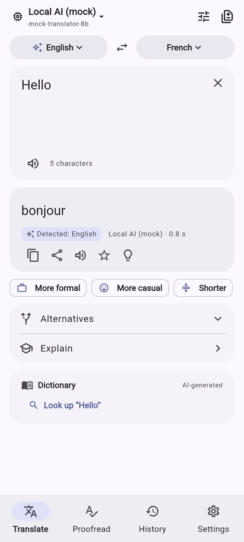
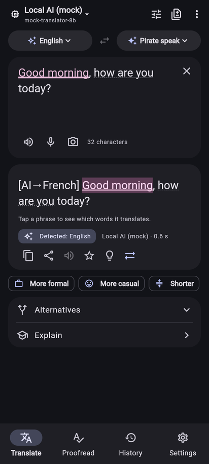
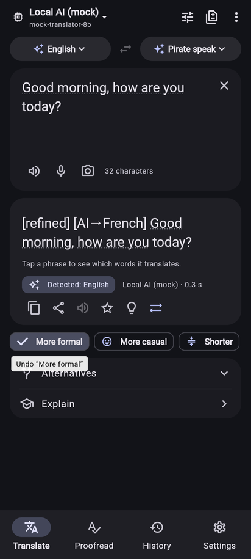
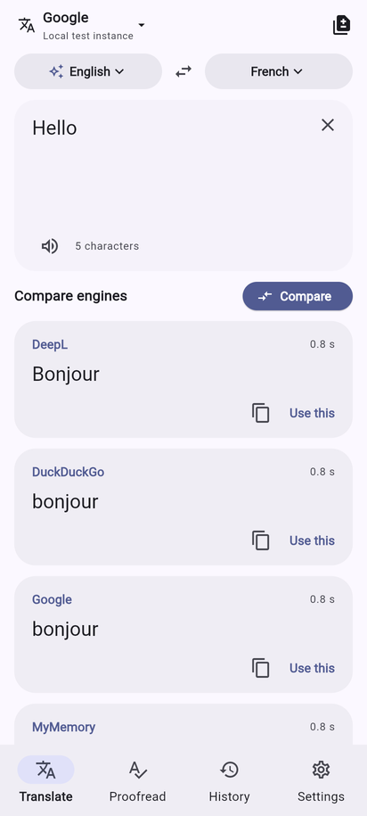
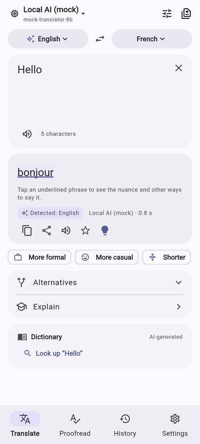
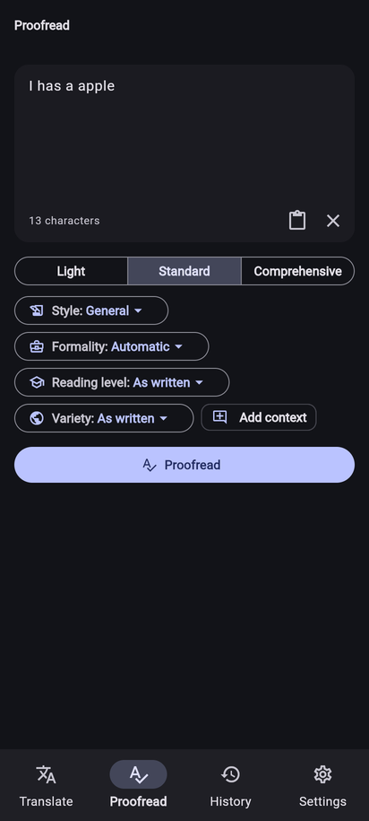
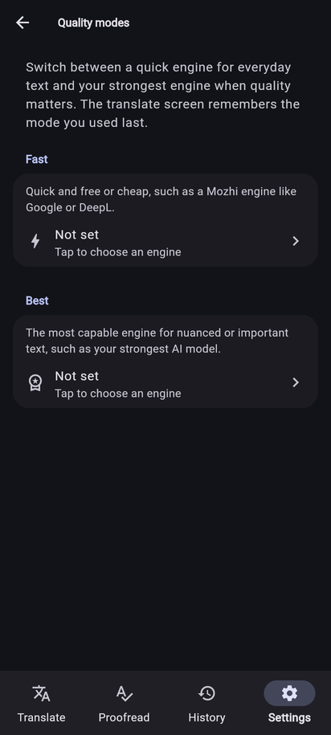
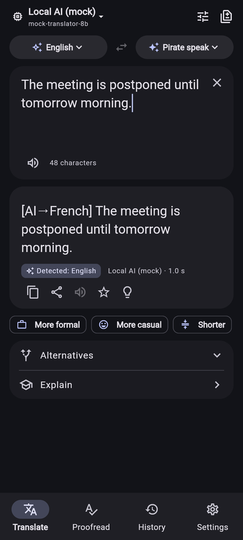
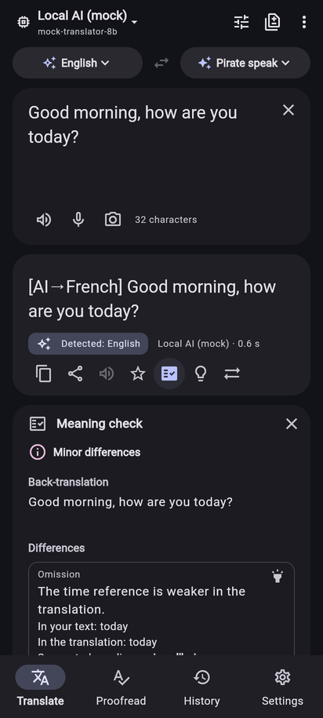
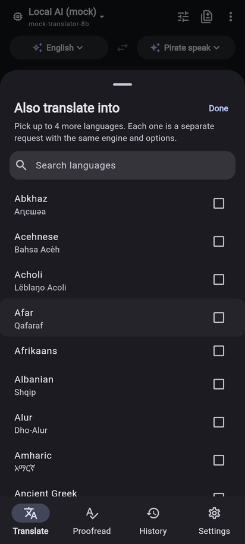

# Mozhi

[](https://github.com/Aimdi/Mozhi/actions/workflows/main.yaml)
[![style: very good analysis][very_good_analysis_badge]][very_good_analysis_link]
[![License: MIT][license_badge]][license_link]

A fast, private translator for Android and the web.

Mozhi is a client for self-hostable [Mozhi][mozhi] translation instances (the
privacy front-end for Google, DeepL, Reverso, Yandex, LibreTranslate and more)
and an AI translator that works with any OpenAI-compatible, Anthropic, Gemini
or Ollama endpoint, including models that run on your own machine. The aim is
to feel as good as Kagi Translate, without an account and without sending your
history anywhere.

---

## Features

**Translation engines**

- Every engine your Mozhi instance offers (Google, DeepL, Reverso, Yandex,
  LibreTranslate, DuckDuckGo, MyMemory, ...), with automatic failover across
  your ordered list of instances.
- **Compare mode**: run all engines (or the ones you pick) side by side and
  keep the best result.
- **AI providers**: OpenAI, Anthropic (Claude), Google Gemini, OpenRouter,
  Groq, DeepSeek, Mistral, xAI, Together, and local runtimes (Ollama,
  LM Studio, llama.cpp server) or any OpenAI-compatible URL. Local engines
  get a privacy badge. Dedicated translation models (TranslateGemma,
  Hunyuan-MT) get their own prompt format.
- **DeepL API and LibreTranslate** with your own key or server, and
  **offline** translation on Android with Mozilla's Bergamot engine and the
  Firefox Translations models (MPL-2.0, about 55 languages).
- **Quality modes**: a Fast and a Best engine you pick once, switched with
  one tap and remembered (Kagi's Standard / Best).
- Long texts are split at paragraph boundaries and translated in parallel
  with context from the preceding part.

**Kagi-style AI extras**

- Options: natural or literal style, formality, reading level (CEFR A1 to C2),
  speaker and addressee gender, free-form context, glossary.
- Custom target "languages" such as *Pirate speak*, *Plain English* or
  *LinkedIn speak*.
- Alternatives (for the whole text or a selected span), word insights with
  variations, *Explain this translation*.
- Refinement chips (*More formal*, *More casual*, *Shorter*, ...) edit the
  current translation instead of starting over; they stack, exclude each
  other within a group and can be undone.
- **Alignment**: tap a phrase to highlight it in both the source and the
  translation. **Romanization** under non-Latin output (Hepburn, Pinyin,
  Revised Romanization, IAST, ...).
- **Check meaning**: on demand, the model back-translates the translation
  and lists real differences in meaning (omission, addition, negation,
  number, tense, mistranslation), highlighted in both texts, with a verdict
  (*Same meaning*, *Minor differences*, *Meaning differs*). Without an AI
  model, a plain back-translation by your engine to compare.
- Uncertain language detection for short input offers the likely
  alternatives; a free-form *source* style (e.g. *LinkedIn speak*) can be
  decoded into plain language.
- **Dictionary** page and card: senses, pronunciation, examples, related
  words, *Did you mean ...?*, three levels of detail.
- AI engines can still assist while a Mozhi engine translates.
- **Proofread** tab: corrections with explanations, writing style,
  correction level, target reading level, regional variety (keeps or
  converts en-GB/en-US, pt-BR/pt-PT, ...) and local writing statistics
  (Flesch reading ease for English).

**Everyday use**

- Instant translation while typing (debounced; optional for AI engines),
  detected source language with smart swap, transliteration.
- **Also translate into…** up to four more languages at once (remembered),
  with the same engine and options, each with copy, listen and
  use-as-input.
- **Read aloud** with Mozhi or device voices: speech rate from 0.5× to 1.5×
  with a preview, a device voice per language, or device voices for
  everything (offline once installed). Long-press **Listen** (or More tools,
  right click, Shift+Enter) to hear a text again slowly.
- **History and favourites**, searchable, with JSON export and import and
  optional automatic deletion after 1, 7 or 30 days (favourites are kept).
- Recent language pairs (long-press the swap button), Alt+1...9 for pinned
  target languages, and an undo when the app swaps languages for you.
- **Usage & costs**: characters and estimated tokens per AI provider per
  month, with optional monthly budgets and warnings.
- **Android**: *Translate with Mozhi* in the text-selection menu of any app
  opens a quick-translate sheet (with *Replace* for editable fields and
  *Open in app*), plus a share target for text.
- Links like `/translate?text=hola&from=es&to=en` open pre-filled (same
  parameters as Kagi Translate, including style, formality, reading level
  and `quality`; `q`, `sl` and `tl` work too; free-text context from links
  is ignored), plus
  `/proofread?text=...`, `/dictionary?word=...` and `mozhi://` deep links.
- Material 3 with Material You colours, dark mode and pure-black mode;
  bottom navigation on phones and a navigation rail on tablets and wide
  browser windows.

**Privacy**

- No account, no telemetry, no analytics, and no Google code in the default
  build (GitHub releases and F-Droid).
- **Privacy modes**: Offline only, Offline first (the default: on-device
  when possible, and Mozhi asks before text goes over the network) or
  Online. Cloud providers always ask once, and a chip under every
  translation names who received the text.
- History and settings stay on the device and are never backed up or
  transferred; the history is encrypted (AES-256-GCM). API keys, custom
  headers and instance passwords are kept in the platform's secure storage
  (in the web app only for the browser session). Where secure storage is
  unavailable the app says so and keeps keys in memory.
- Incognito, a screenshot and recents blocker, sensitive copies, an HTTP
  proxy (Orbot/Tor), https-only for public servers, and **Delete all local
  data**.
- Shared text and links never start a paid AI request on their own. (Choosing
  *Translate with Mozhi* on a text selection is an explicit request: it
  translates right away with your current engine.)
- Your text only goes to the Mozhi instance or AI provider you choose. Run both
  yourself and nothing leaves your network.

### Screenshots

| Translate with AI | Alignment | Refine | Compare engines |
| --- | --- | --- | --- |
|  |  |  |  |
| **Word insights** | **Proofread** | **Quality modes** | **Dark mode** |
|  |  |  |  |
| **Check meaning** | **Extra languages** | | |
|  |  | | |

---

## Screens & features

Besides the four tabs (Translate, Proofread, History, Settings):

| Screen | Where | What it does |
| --- | --- | --- |
| Onboarding | first start | Privacy mode, your languages (with offline downloads on Android) and, optionally, a public or your own Mozhi instance |
| Image | Translate > More tools | Photos and screenshots: on-device text recognition (Tesseract, the default on Android; ML Kit in the Play variant), AI vision, or Mozhi via Google Translate (experimental) |
| Documents | Translate > More tools | `.txt`, Markdown, SRT/VTT subtitles and JSON/ARB string tables, saved or shared when done |
| Web page | Translate > More tools | Reader view of a page, translated block by block |
| Conversation | Translate > More tools | Two people, two languages, with voice input and read-aloud |
| Voice input | microphone buttons | Dictation, optionally on-device only |
| Offline languages | Settings | Firefox Translations models for translating without a network (Android) |
| Presets and glossaries | Settings | Named option sets and term lists for AI translation |
| Usage | Settings | Requests and characters per AI provider this month, with optional budgets |
| Quick translate | Android selection menu | Translate a selection in place without leaving the other app |

Documentation:

- [Getting started](docs/getting-started.md): install, first run, Android
  shortcuts
- [Features](docs/features.md): a tour of everything above
- [AI providers](docs/ai-providers.md): keys, base URLs, models, local models
- [Self-hosting Mozhi](docs/self-hosting-mozhi.md): your own instance with
  Docker Compose, HTTPS, LAN and Tor
- [Privacy](docs/privacy.md): what stays on the device and what each back end
  sees
- [FAQ](docs/faq.md)
- [Architecture](docs/architecture.md): packages, layers and data flow (for
  contributors)

---

## Install

- **Android**: download an APK from [Releases][releases] (or the `mozhi-android`
  artifact of a recent [CI run][actions]). Pick `arm64-v8a` for almost every
  modern phone, `armeabi-v7a` for old 32-bit devices, or `universal` if unsure.
  Check downloads against `SHA256SUMS.txt`.
- **Web**: there is no hosted copy; serve it yourself from any static web
  server. Each [release][releases] has a `mozhi-<version>-web.zip`, and every
  [CI run][actions] produces the same static build as the `mozhi-web`
  artifact. Both are built for the root of a server (base href `/`; set the
  `WEB_BASE_HREF` repository variable to change it for CI). To serve it from
  a sub-path, edit `<base href>` in `index.html` or build it yourself with
  `--base-href` (see below). It makes no requests to a CDN.

> APKs built without the release signing secrets are signed with a throwaway
> debug key. Android refuses to update an app signed with a different key, so
> uninstall first when switching between such builds.

---

## Connect your own Mozhi instance

A list of public instances is built in, but running your own takes a minute:

```sh
docker run -d --name mozhi --restart unless-stopped \
  -p 3000:3000 codeberg.org/aryak/mozhi:latest
```

(or use the `compose.yml` from the [Mozhi repository][mozhi]). Then open
**Settings > Mozhi instances**, add `http://<your-server-ip>:3000` and move it to
the top. Plain `http` on your LAN is allowed.

The web build calls instances from the browser, so a self-hosted instance used
from the web app must send CORS headers (for example via your reverse proxy).
The Android app does not need this.

## Connect an AI provider

Open **Settings > AI providers > Add** and pick a preset:

| Provider | Base URL | Notes |
| --- | --- | --- |
| OpenAI | `https://api.openai.com/v1` | API key |
| Anthropic | `https://api.anthropic.com/v1` | API key |
| Google Gemini | `https://generativelanguage.googleapis.com/v1beta` | API key from Google AI Studio |
| OpenRouter | `https://openrouter.ai/api/v1` | API key, hundreds of models |
| Groq | `https://api.groq.com/openai/v1` | API key, very fast |
| Ollama | `http://<pc-ip>:11434` | local, no key |
| LM Studio | `http://<pc-ip>:1234/v1` | local, no key |
| llama.cpp server | `http://<pc-ip>:8080/v1` | local, no key |
| Custom | any OpenAI-compatible URL | optional key and headers |

Use **Test** in the editor to send a tiny translation before saving.

**Local models on another computer.** `localhost` on a phone is the phone
itself; use your computer's LAN address instead (for example
`http://192.168.1.20:11434`), and make the server listen on the network:

- **Ollama**: start it with `OLLAMA_HOST=0.0.0.0` (for example
  `OLLAMA_HOST=0.0.0.0 ollama serve`, or set it in the systemd service /
  app settings). For the **web** build also set `OLLAMA_ORIGINS` to the web
  app's origin (or `*`) so the browser may call it.
- **LM Studio**: Developer tab, *Serve on Local Network* (and *Enable CORS*
  for the web build).
- **llama.cpp**: `llama-server -m model.gguf --host 0.0.0.0 --port 8080`.

Instruction-tuned models of 7B parameters or more give good results; smaller
models work for common language pairs.

---

## Build from source

Requirements: Flutter 3.47 (Dart 3.13). Android builds need JDK 17 and the
Android SDK.

```sh
flutter pub get

# Run (flavors: development, staging, production)
flutter run --flavor development -t lib/main_development.dart
flutter run --flavor production -t lib/main_production.dart

# Android release APKs
flutter build apk --release --flavor production -t lib/main_production.dart --split-per-abi

# Web (CanvasKit served from the build, not from Google's CDN; use e.g.
# --base-href /mozhi/ to serve it from a sub-path)
flutter build web --release -t lib/main_production.dart \
  --base-href / --no-web-resources-cdn
```

The three flavors install side by side on Android (`io.github.aimdi.mozhi`,
`.stg`, `.dev`).

### APK signing secrets

Release builds use, in this order: the environment variables
`ANDROID_KEYSTORE_PATH`, `ANDROID_KEYSTORE_PASSWORD`, `ANDROID_KEY_ALIAS` and
`ANDROID_KEY_PASSWORD`; or `android/key.properties` (`storeFile`,
`storePassword`, `keyAlias`, `keyPassword`); otherwise the debug key.

In GitHub Actions (Settings > Secrets and variables > Actions), add:

| Secret | Value |
| --- | --- |
| `ANDROID_KEYSTORE_BASE64` | The keystore, base64-encoded: `base64 -w0 release.jks` |
| `ANDROID_KEYSTORE_PASSWORD` | Keystore password |
| `ANDROID_KEY_ALIAS` | Key alias |
| `ANDROID_KEY_PASSWORD` | Key password |

Without them CI signs with a throwaway debug key (see the note under
[Install](#install)).

**Releases.** Pushing a tag such as `v1.0.0` builds the APKs, the app bundle
and the web zip and publishes a GitHub release.

### Tests

```sh
flutter test --coverage                       # app
(cd packages/translation_repository && dart test)   # each package
dart run bloc_tools:bloc lint lib             # bloc lints
```

---

## Architecture

A layered Flutter app with pure Dart packages:

| Path | Role |
| --- | --- |
| `packages/mozhi_api` | Client for the Mozhi REST API (`/api/translate`, `/api/engines`, languages, TTS, ...). |
| `packages/llm_api` | Streaming clients for OpenAI-compatible, Anthropic, Gemini and Ollama APIs. |
| `packages/translation_repository` | Domain models, language catalogue, prompts and parsers, and `TranslationRepository`, which unifies Mozhi engines and AI providers (failover, caching, compare, extras). |
| `packages/mt_api` | Clients for machine translation services (DeepL, LibreTranslate). |
| `packages/bergamot_translator` | Offline translation (Android) behind `OfflineTranslator`: Mozilla's Bergamot engine over `dart:ffi`, the Firefox Translations model catalogue, verified downloads. See [Offline engine](docs/offline-engine.md). |
| `packages/mlkit_translator` | ML Kit translation, kept for reference; no build uses it. |
| `packages/mozhi_cli` | Command-line client. |
| `lib/app` | Bootstrap wiring, router (`go_router`), adaptive shell, theme, shared-text and link handling. |
| `lib/translate`, `lib/proofread`, `lib/history`, `lib/settings` | Features: Cubits (`flutter_bloc`) and views. |
| `lib/image_translate`, `lib/documents`, `lib/web_translate`, `lib/conversation`, `lib/quick_translate` | Other translators (full-screen routes and the quick-translate sheet). |
| `lib/onboarding`, `lib/presets`, `lib/offline`, `lib/usage`, `lib/voice` | First run, presets and glossaries, offline models, usage tracking, voice input. |
| `lib/speech`, `lib/platform` | Text-to-speech and the Android share / text-selection bridge. |

User-facing strings live in `lib/l10n/arb`.

---

## Verify a release

Each [release][releases] has `SHA256SUMS.txt`, and every APK is signed with
the project's release key. In the folder with your downloads:

```sh
sha256sum --ignore-missing -c SHA256SUMS.txt
apksigner verify --print-certs mozhi-<version>-arm64-v8a.apk | grep SHA-256
```

The signing certificate's SHA-256 must be:

```text
664e9435c343dc1961a91e9efcbe43e86bb6a4cb058de94afe5dc9af22e884a4
```

(`keytool` prints the same value in capitals with colons:
`66:4E:94:35:…:22:E8:84:A4`.)

`apksigner` comes with the Android SDK build-tools (`apt install apksigner`
on Debian and Ubuntu). The checksums only prove the download is intact,
because they come from the same release. The certificate shows who signed
it.

The default APKs contain no Google code. To check one from a checkout, run
`sh tool/check_no_google.sh <apk>`.

More: [Releasing](docs/release.md) and
[Building and reproducible builds](docs/building.md).

---

## License

[MIT](LICENSE). Mozhi (the translation front-end) is a separate project by
its own authors; this app is an independent client.

[mozhi]: https://codeberg.org/aryak/mozhi
[releases]: https://github.com/Aimdi/Mozhi/releases
[actions]: https://github.com/Aimdi/Mozhi/actions/workflows/main.yaml
[license_badge]: https://img.shields.io/badge/license-MIT-blue.svg
[license_link]: https://opensource.org/licenses/MIT
[very_good_analysis_badge]: https://img.shields.io/badge/style-very_good_analysis-B22C89.svg
[very_good_analysis_link]: https://pub.dev/packages/very_good_analysis
