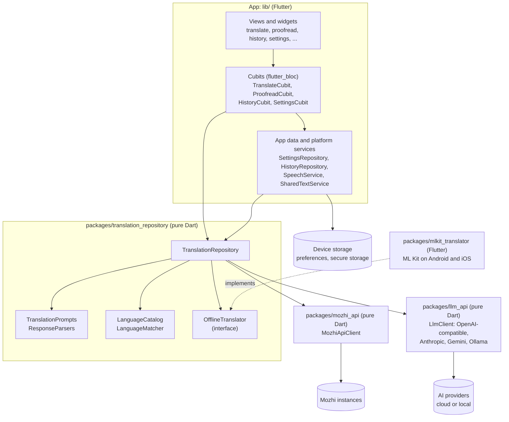
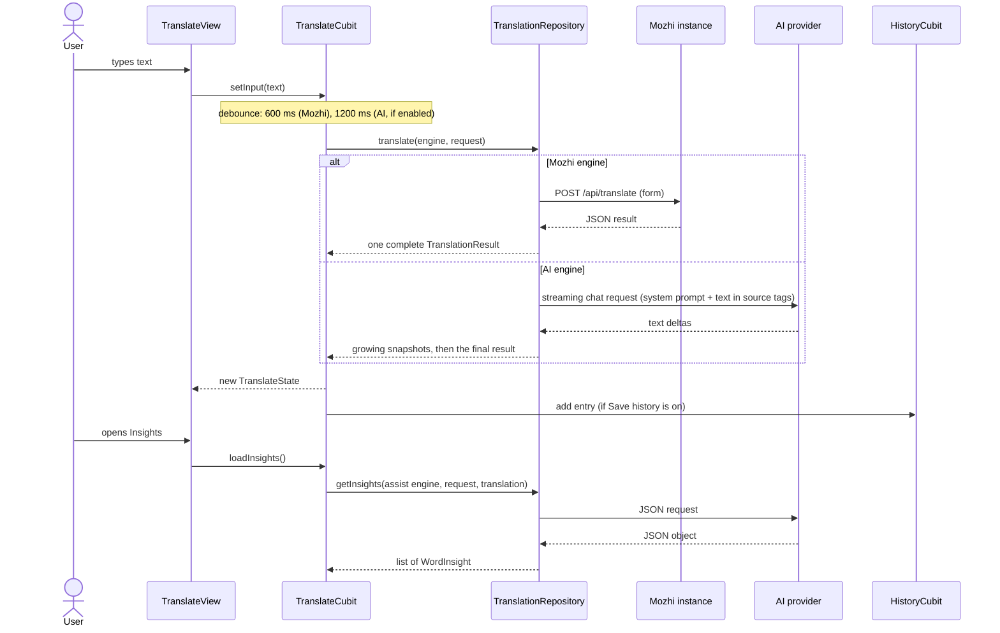

# Architecture

Mozhi is a Flutter app on top of pure Dart packages and one Flutter plugin
package. Network clients know nothing about Flutter, the domain layer knows
nothing about widgets, and the app layer holds state in Cubits.

- [Packages and layers](#packages-and-layers)
- [The app layer](#the-app-layer)
- [Data flow of a translation](#data-flow-of-a-translation)
- [Settings, secrets and history](#settings-secrets-and-history)
- [Errors, failover and caching](#errors-failover-and-caching)
- [Text from other apps](#text-from-other-apps)
- [How to add an AI provider](#how-to-add-an-ai-provider)

## Packages and layers



| Package | Depends on | Responsibility |
| --- | --- | --- |
| `packages/mozhi_api` | `http` | One `MozhiApiClient` per instance: `/api/translate`, `/api/engines`, `/api/source_languages`, `/api/target_languages`, `/api/tts`, `/api/image`, `/api/version`. URL normalisation, timeouts, typed models, `MozhiApiException` with `isRetryable`. |
| `packages/llm_api` | `http` | Streaming chat clients for the four wire protocols (`LlmProvider`): OpenAI-compatible (SSE), Anthropic Messages (SSE), Gemini (SSE) and Ollama native (NDJSON). Model listing, cancellation, reasoning-tag filtering, error extraction into `LlmApiException` / `LlmRefusalException`. Uses only `package:http`, so it runs on the web. |
| `packages/translation_repository` | `mozhi_api`, `llm_api` | Domain models (`TranslationEngine`, `TranslationRequest`, `TranslationResult`, `TranslationOptions`, `AiProviderConfig` and its presets, `MozhiInstance`, ...), the ~290-language catalogue, prompt construction and response parsing, and `TranslationRepository`, the single entry point that unifies Mozhi engines, AI providers and the offline engine. |
| `packages/mlkit_translator` | `translation_repository`, Google ML Kit | Implements `OfflineTranslator` with on-device ML Kit translation and language identification (Android and iOS). |
| `packages/mt_api` | `http` | Clients for classic machine-translation APIs (DeepL API v2 and LibreTranslate). |
| `packages/mozhi_cli` | `mozhi_api`, `llm_api`, `translation_repository` | A command-line translator built on the same packages. |
| `lib/` | the packages above | UI, state, persistence and platform integration. |

The packages are contract-first: their public APIs are kept stable so that
features can be built in parallel. Each package has its own unit tests.

## The app layer

```text
lib/
  app/          bootstrap wiring (AppDependencies), App widget, go_router
                router, adaptive shell, theme, translate links, shared text
  core/         KeyValueStore abstraction (preferences / secure storage)
  translate/    TranslateCubit + translate screen widgets
  proofread/    ProofreadCubit + Proofread tab
  history/      HistoryRepository, HistoryCubit, History tab
  settings/     AppSettings model, SettingsRepository, SettingsCubit, pages
  speech/       SpeechService (text-to-speech playback)
  platform/     SharedTextService (Android share / text selection bridge)
  image_translate/, voice/, documents/, offline/, presets/, onboarding/,
  conversation/, quick_translate/, usage/, web_translate/
                feature modules, each with its own Cubits and views
  l10n/         ARB files and generated localisations
```

- **Bootstrap.** `bootstrap.dart` creates the long-lived services
  (`createDependencies`), loads the saved settings, configures the
  `TranslationRepository` and runs the app. `main_development.dart`,
  `main_staging.dart` and `main_production.dart` are the flavor entry points.
- **State.** `flutter_bloc` Cubits with `equatable` states. `SettingsCubit`,
  `HistoryCubit` and `TranslateCubit` live for the whole app (so text shared
  from other apps can be routed to the translate screen); feature pages
  provide their own Cubits with the Page/View split (`XPage` provides, `XView`
  builds).
- **Configuration sync.** Whenever the instance or provider settings change,
  the app calls `TranslationRepository.updateConfiguration(...)`, which
  replaces the instance list and provider configs and clears the affected
  caches.
- **Routing.** `go_router` with a `StatefulShellRoute` that keeps the four
  tabs (Translate, Proofread, History, Settings) alive. Settings sub-pages are
  nested routes (`/settings/instances`, `/settings/providers/edit?id=…`, ...).
- **Layout.** `AppShell` shows a bottom navigation bar on phones and a
  navigation rail from 840 dp; the translate screen puts input and output
  side by side on wide screens.

## Data flow of a translation



Details worth knowing:

- **Requests.** A `TranslationRequest` carries the text, source and target
  `Language` and the `TranslationOptions`. Custom targets (`Language.custom`,
  e.g. "Pirate speak") are only valid for AI engines.
- **Streaming.** AI translations are streamed; snapshots are throttled, the
  `[[lang:xx]]` marker the model prepends for auto-detection is parsed into
  `detectedSource` and never shown, `<think>` content is dropped, and the
  final text is cleaned of quotes, labels and trailing notes. Cancelling the
  stream subscription aborts the HTTP request, so typing on cancels the
  previous translation.
- **Prompts.** `TranslationPrompts` builds every prompt as pure functions
  (unit-tested on their output). User text only appears in the user message,
  wrapped in tags and declared as data, never in the system prompt.
- **Extras.** Alternatives, insights, suggestions, the dictionary, language
  detection and proofreading ask for a single JSON object; when the reply
  can't be parsed, the repository asks once more for valid JSON only. Explain
  streams Markdown. With a Mozhi main engine, extras go to the *assist engine*
  (`AppSettings.assistEngineId`, or the first enabled AI provider).
- **Compare.** `TranslationRepository.compare` runs engines concurrently and
  emits a `CompareEntry` per engine as soon as it finishes; Mozhi engines are
  batched into one `engine=a,b,c` request.

## Settings, secrets and history

- `AppSettings` is serialised to JSON (`schemaVersion` 1) by
  `SettingsRepository` into the preferences store. Parsing is tolerant:
  unknown or invalid fields fall back to defaults, so old and new versions can
  read each other's data.
- API keys are never part of that JSON. They are stored per provider in
  secure storage (`flutter_secure_storage`, wrapped in a
  `FallbackKeyValueStore` that falls back to memory when secure storage is
  unavailable) and injected into `AiProviderConfig.apiKey` at load time.
- `HistoryRepository` stores history as a JSON list in the preferences store
  (key `history.v1`): newest first, at most 1,000 non-favourite entries,
  favourites never evicted. Export/import use the same JSON.

## Errors, failover and caching

- `MozhiPool` keeps a client per instance and runs each Mozhi call with
  failover: on a retryable error (network failure, timeout, `429`, `5xx`) it
  tries the next instance in list order, and the one that answers becomes the
  preferred instance for the session. Non-retryable errors (`4xx`) are
  rethrown at once.
- Engine and language lists are cached in memory per instance (and per engine
  and direction); failed loads are evicted so the next call retries.
- `LlmPool` caches one client per provider connection.
- The UI maps `MozhiApiException`, `LlmApiException` and
  `LlmRefusalException` to localised messages (unreachable, rate limited,
  authentication, model not found, refused, timeout).

## Text from other apps

On Android, `MainActivity` registers for `ACTION_SEND` (share sheet) and
`ACTION_PROCESS_TEXT` (the "Translate with Mozhi" selection action). Text
arrives through `SharedTextService` (method channel
`io.github.aimdi.mozhi/shared_text` and event channel
`io.github.aimdi.mozhi/shared_text_events`). `SharedTextHandler` switches to
the translate tab and applies it as a `TranslateLink`; for an editable
`PROCESS_TEXT` request it offers **Replace text**, which returns the
translation to the calling app. Kagi-style URLs (`/translate?text=…&from=…
&to=…`) go through the same `TranslateLink` path via the router's redirect.

## How to add an AI provider

### A new preset (most providers)

Most providers speak one of the four existing protocols, usually the
OpenAI-compatible one. Adding them is a data change:

1. Add an `AiProviderPreset` to `_presets` in
   `packages/translation_repository/lib/src/models/ai_provider_config.dart`:

   ```dart
   AiProviderPreset(
     id: 'example',                      // stable, stored in user settings
     name: 'Example AI',
     provider: LlmProvider.openAiCompatible,
     baseUrl: 'https://api.example.com/v1',
     defaultModel: 'example-large',      // '' = user picks from the list
     suggestedModels: ['example-large', 'example-small'],
     apiKeyUrl: 'https://example.com/keys',
     description: 'One line shown in the preset list.',
     defaultEffort: 'low',               // only if the API supports it
   ),
   ```

   Local servers set `requiresApiKey: false` and `isLocal: true`. Extra
   headers go in `headers`.
2. Extend the preset tests in
   `packages/translation_repository/test/src/models/ai_provider_config_test.dart`.
3. Document it in [docs/ai-providers.md](ai-providers.md).

### A new wire protocol

Only needed for an API that none of the existing clients can talk to:

1. Add a value to `LlmProvider` in `packages/llm_api/lib/src/models.dart`
   and document its endpoints.
2. Implement a client in `packages/llm_api/lib/src/providers/` by extending
   `HttpLlmClient`: implement `streamChat` with `abortableStream` + `send`
   (and the `sseEvents` / `responseText` decoders), and `listModels` with
   `getJson`. Emit text deltas only, never reasoning; map HTTP errors to
   `LlmApiException`; honour `LlmRequest.effort`, `jsonOutput` and
   `maxTokens`, and images attached to messages (`LlmImage`), where the API
   allows.
3. Dispatch to it in the `LlmClient` factory
   (`packages/llm_api/lib/src/llm_client.dart`) and export it from
   `llm_api.dart` if needed.
4. Test it against a fake server with `MockClient` from
   `package:http/testing.dart` (see
   `packages/llm_api/test/helpers/fake_server.dart`):
   streaming, cancellation, errors, model listing.
5. In `translation_repository`, accept the new name in
   `AiProviderConfig.fromJson` (`_parseProvider`) and add a preset.
6. In the app, add a label for the provider type in
   `lib/settings/view/provider_editor_page.dart` (a new `settingsProviderType…`
   string, see [localisation](contributing.md#localisation)) and its default
   base URL.
